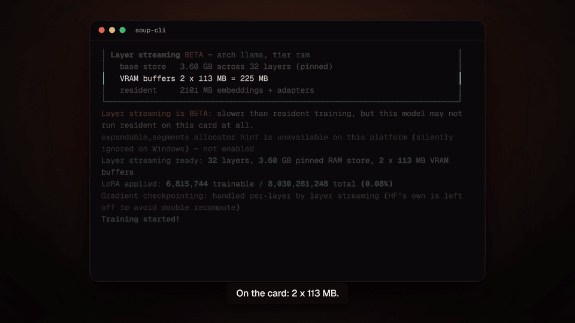
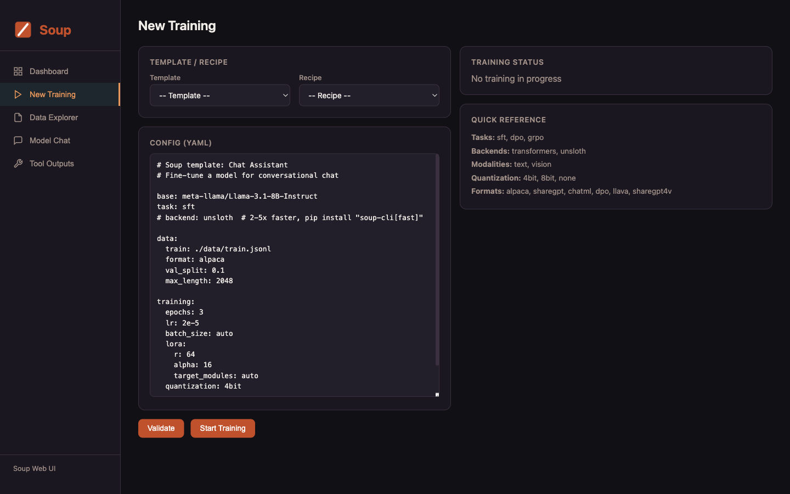

<!-- synced-from: README.md sha256:aa2170df59636760e0235b87cddf967a14e932605ed3abb16480115d99db6e40 -->
<p align="center">🌍 <a href="README.md">English</a> | <a href="README.tr.md">Türkçe</a> | <a href="README.ar.md">العربية</a> | <strong>日本語</strong> | <a href="README.zh.md">中文</a></p>

<p align="center">
  
</p>

<h1 align="center">Soup</h1>

<p align="center">
  <strong>コマンド一つで、LLM のファインチューニングとポストトレーニングを。SSH も、設定地獄も不要です。</strong>
</p>

<p align="center">
  <a href="https://trysoup.dev">ウェブサイト</a> &middot;
  <a href="#クイックスタート">クイックスタート</a> &middot;
  <a href="#web-ui">Web UI</a> &middot;
  <a href="#設定">設定</a> &middot;
  <a href="#ドキュメント">ドキュメント</a> &middot;
  <a href="docs/commands.md">コマンド</a> &middot;
  <a href="docs/models.md">モデル</a> &middot;
  <a href="https://discord.gg/dgd2pJcjwP">Discord</a> &middot;
  <a href="https://t.me/souptasters">Telegram</a> &middot;
  <a href="https://www.producthunt.com/products/soup-cli">Product Hunt</a>
</p>

<p align="center">
  <a href="https://pypi.org/project/soup-cli/"></a>
  <a href="https://pepy.tech/project/soup-cli"></a>
  
  
  <a href="https://github.com/MakazhanAlpamys/Soup/actions"></a>
  <a href="https://github.com/MakazhanAlpamys/Soup/actions"></a>
  <a href="https://trysoup.dev"></a>
  <a href="https://discord.gg/dgd2pJcjwP"></a>
  <a href="https://t.me/souptasters"></a>
  <a href="https://doi.org/10.5281/zenodo.21771064"></a>
</p>

<p align="center">
  <a href="https://www.producthunt.com/products/soup-cli?embed=true&amp;utm_source=badge-featured&amp;utm_medium=badge&amp;utm_campaign=badge-soup-cli">
    <picture>
      <source media="(prefers-color-scheme: dark)" srcset="https://api.producthunt.com/widgets/embed-image/v1/featured.svg?post_id=1217869&amp;theme=dark">
      
    </picture>
  </a>
  <a href="https://trendshift.io/repositories/98395?utm_source=repository-badge&amp;utm_medium=badge&amp;utm_campaign=badge-repository-98395" target="_blank" rel="noopener noreferrer">
    
  </a>
</p>

---

Soup は、LLM のファインチューニングの面倒をシンプルなワークフローに変えます。設定ファイルは一つ、コマンドも一つ。それだけです。

```bash
pip install "soup-cli[train]"   # ファインチューニングには [train] を追加します。素の soup-cli は軽量な CLI です
soup init --template chat
soup train
```

**4 GB のノート PC 用 GPU で、8B モデルをファインチューニングできます。** レイヤーストリーミングは、凍結したベースモデルを
VRAM の外に置き、デコーダー層を一層ずつ GPU に送り込みます。RTX 3050 Laptop 4 GB での実測値:
Llama-3.1-8B-Instruct + NF4 で **952 MHz 時に 119.6 tok/s、ピーク 3.32 GB**（修正前）— 全体をメモリに常駐させた通常の実行とビット単位で
完全に一致し、H100 でも同じ 3.32 GB で 113.00 tok/s と独立に再現されました。
（どちらの数値も v0.72.2 で、v0.73.0 の正確性修正（32B で −4.8% のコスト）より前に測定したものです。
修正後の実行は、別の RTX 3050 Laptop 4 GB（@umran666、#1103）で
**1935–1957 MHz 時に 208.6 tok/s、ピーク 2.40 GB** でした。これは同一セッションでの GEMM 上限の 59% にあたり、
修正前の 68% に対して、クロックあたりでは約 14% 遅いことになります。つまり、見かけの 1.74x の向上は高速化ではなく
クロックの差です。大きなレイヤーのストリーミングによって両行のあいだでメモリの使われ方も変わっているため、この割合でさえ
同じ条件での比較ではありません — [記録](benchmarks/gate-v0.72.2-nf4.md)。）オプトイン方式（`stream_layers: true`）で、
まだ BETA です —
[仕組み](docs/performance-and-quantization.md#layer-streaming-beta-v0720-nf4-v0722-disk--wider-archs-v0723-preference-losses-v0724) ·
[すべての測定結果](benchmarks/) · [論文](https://doi.org/10.5281/zenodo.21771064) ·
**[無料の Colab T4 で自分で確かめる](notebooks/proof-4gb.ipynb)**（プロセスを 4 GB に制限した上で、
ストリーミングしたモデルが通常のモデルとビット単位で同一であることを検証します）

<p align="center">
  <a href="https://youtu.be/T1LCErE943E"></a><br>
  <sub>Llama-3.1-8B-Instruct + NF4、LoRA、バッチサイズ 1、シーケンス長 512、RTX 3050 Laptop 4 GB — <b>ピーク 3.32 GB、119.6 tok/s</b>、952 MHz 時（修正前、v0.72.2。#331 修正後: 1935 MHz 時に 208.6 tok/s、2.40 GB。直接の比較はできません。@umran666、#1103）。 <a href="https://youtu.be/T1LCErE943E">動画（90 秒）</a></sub>
</p>

## なぜSoupなのか

LLM の学習は、今でも骨の折れる作業です。経験豊富なチームでさえ、時間の 30〜50% を、モデルの改善ではなく
インフラとの格闘に費やしています。Soup はそれを解決します。

- **SSH 不要。** 故障した GPU マシンに二度と SSH で入る必要はありません。
- **設定は一つ。** 必要なのはシンプルな YAML ファイルだけです。
- **すべて自動。** バッチサイズ、GPU の検出、量子化 — すべてお任せです。
- **ローカルで動作。** QLoRA を使って手元の GPU で学習できます。クラウドは不要です。

## 新着情報

**v0.77.1 — パッチリリース：`soup data` が入力を守り、`soup plan` が `soup train` と同じ判断をし、
GRPO が Apple Silicon で学習できるようになりました。** v0.77.0 で入ったものは何も取り消されていません。v0.77.0 は
v0.76 が警告した設定や無視した設定を拒否するため、v0.76 で読み込めた設定が読み込めなくなることがあります。
0.76.x から移行する場合は、まず `soup doctor --config soup.yaml` を実行し、
[v0.77.0 のリリースノート](https://github.com/MakazhanAlpamys/Soup/releases/tag/v0.77.0)を読んでください。

- **`soup data` のコマンドが入力を上書きしなくなりました。** そのうち十八個（`dedup`、`filter`、
  `convert`、`merge`、`sample`、`pii`、`toxicity` など）は、どのような書き方であっても入力と同じファイルを
  指す `--output` を、何も読み込む前に拒否します。入力がすでに使っている既定の出力名も拒否されます。
  代わりに新しいファイルへ書き出してください。
- **`soup plan` と `soup apply` は、`soup train` が拒否する設定を**同じメッセージで拒否し、プランを
  書き込みません。
- **GRPO が Apple Silicon でネイティブに学習できます。** `backend: mlx` の `task: grpo` は、
  transformers 経路が学習するのと同じ目的関数で Soup 独自の MLX ループを実行し、組み込みの `accuracy`
  または `format` 報酬を使います。`soup infer --backend mlx` は、MLX のベースモデルとネイティブの
  テキスト LoRA アダプターから Torch なしで生成します。
- **ピーク VRAM の推定がひとつになりました。** `soup train` の事前チェック、`soup profile`、`soup plan` が
  同じ推定を使い、39 回の実測で較正されています（[記録](benchmarks/gate-2049-resident-vram.md)）。
  推定が較正された範囲、つまり約 3.5B パラメータまでの dense モデルでは、事前チェックはこれまで通していた
  長いシーケンス・大きな語彙の実行の一部を拒否するようになりました。`--allow-oom-attempt` を付ければ
  引き続き起動できます。その範囲外（より大きなモデルや mixture-of-experts モデル、`medium` または
  `selective` のチェックポイント、`use_liger` / `use_cut_ce`、`backend: unsloth`）では、収まらない実行に
  ついて推定を警告として表示し、実行を開始します。ただし、重み、CUDA コンテキスト、学習するパラメータの
  勾配とオプティマイザ状態だけでカードの容量を超える実行（80 GB での 7B のフルファインチューニング、
  24 GB での 4-bit の Llama-3.1-70B）は、範囲外でも拒否されます。LoRA の実行や一部のパラメータだけを
  学習する実行（Spectrum、LISA、凍結）は、より少ない項目で判定されます。`--allow-oom-attempt` を
  付ければ、拒否された実行も起動できます。
- **外部プログラムは `PATH` 上で見つかった絶対パスで起動されます。** カレントディレクトリと相対的な
  `PATH` エントリは検索されなくなりました。そこにしかないツールは、そのディレクトリを `PATH` に
  加えてください。
- **その他の新機能。** `soup ship --progress jsonl`、他のライブラリの名前で書かれた未知の設定キーに
  対応する Soup のフィールドの提案（`learning_rate` には `lr`）、そして下の Docker の例が、v0.77.0 以降の
  非対話的な `soup train` に必要な `--yes` を渡すようになりました。

過去のハイライトは [GitHub Releases](https://github.com/MakazhanAlpamys/Soup/releases) ページにあります。

## クイックスタート

### 1. インストール

Soup はコマンドラインアプリケーションなので、最もきれいなインストール方法は、専用の環境を与えて
`soup` を `PATH` に置くことです。

```bash
# 軽量コア: CLI + 設定 + データツール。PyTorch は含みません
pipx install soup-cli
uv tool install soup-cli          # 同じ考え方です。すでに uv を使っている場合

# 学習スタックを追加（torch、transformers、peft、trl、datasets、…）
pipx install "soup-cli[train]"

# すべて（train + serve + ui + data）を一度に
pipx install "soup-cli[all]"

# または GitHub から（最新の開発版）
pipx install "git+https://github.com/MakazhanAlpamys/Soup.git"
```

すでに virtualenv、Colab ノートブック、Docker イメージの中にいる場合は、同じ名前とエクストラで `pip` を
直接使ってください。

```bash
pip install soup-cli
pip install "soup-cli[train]"
pip install "soup-cli[all]"
pip install git+https://github.com/MakazhanAlpamys/Soup.git
```

自分のコードから `import soup_cli` もしたい場合は、`pipx` ではなく `pip` を使ってください。
pipx は意図的にアプリケーションを他のすべてから分離するためです。

エクストラの完全な一覧（`fast`、`mlx`、`serve`、`eval`、`ui`、`vision`、`audio`、…）は
[`docs/models.md`](docs/models.md#optional-extras) にあります。

> **`error: externally-managed-environment` と出ましたか?** これは
> [PEP 668](https://peps.python.org/pep-0668/) によるもので、Soup の問題ではありません。Debian 12、
> Ubuntu 23.04 以降では、`apt` もそれらのファイルを管理しているため、`pip` がシステムの Python に書き込め
> ないようになっています。`pipx` と `uv tool` は、Soup に専用の環境を与えることでこれを回避します。上で最初に
> 挙げているのはそのためです。`python3 -m venv .venv && source .venv/bin/activate` を実行してから通常の
> `pip` を使う方法でも、同じように動作します。

> **ダブルクォートを使い、シングルクォートは使わないでください。** `"soup-cli[train]"` は、`cmd.exe`、
> PowerShell、bash、zsh のどのシェルでも動作する唯一の書き方です。古いチュートリアルから
> `'soup-cli[train]'` をコピーして pip に拒否された場合は、これが理由です:
> [理由と正確なエラー](docs/models.md#quoting-the-extra)。

`soup init`、`soup data …` などのデータ／検査系コマンドは、軽量インストールで動作します。
ファインチューニング（`soup train`）には `[train]` エクストラが必要です。

### 2. 設定ファイルを作成する

```bash
soup init                       # 対話型ウィザード
soup init --template chat       # またはテンプレートから始める
```

テンプレート: `chat`、`code`、`tool-calling`、`medical`、`reasoning`、`vision`、`kto`、`orpo`、
`simpo`、`ipo`、`bco`、`rlhf`、`pretrain`、`moe`、`longcontext`、`embedding`、`audio`。

### 3. 学習・テスト・公開

```bash
soup train --config soup.yaml                 # LoRA、量子化、バッチ処理 — すべてお任せ
soup chat  --model ./output                    # モデルと対話する
soup push  --model ./output --repo you/my-model

soup merge  --adapter ./output                              # LoRA をベースにマージ
soup export --model ./output --format gguf --quant q4_k_m   # Ollama / llama.cpp 向けの GGUF
```

その他のエクスポート先（ONNX、TensorRT、BitNet）とデプロイのオプションは、
[`docs/serving-and-export.md`](docs/serving-and-export.md) にあります。

## Web UI

ブラウザのほうがお好みですか? `soup ui` は、実験、学習のセットアップ、ライブメトリクス、データセットの探索、
モデルとのチャットのためのローカルダッシュボードを提供します。

```bash
pip install "soup-cli[ui]"
soup ui
# http://127.0.0.1:7860/?token=<token> を開きます
```



[Web UI のドキュメント](docs/serving-and-export.md#web-ui)

## 設定

完全な `soup.yaml` の例:

```yaml
base: meta-llama/Llama-3.1-8B-Instruct
task: sft
# backend: unsloth  # 2〜5 倍高速、pip install "soup-cli[fast]"

data:
  train: ./data/train.jsonl
  format: alpaca
  val_split: 0.1

training:
  epochs: 3
  lr: 2e-5
  batch_size: auto
  lora:
    r: 64
    alpha: 16
  quantization: 4bit

output: ./output
```

`config/schema.py` は、すべてのフィールドの唯一の信頼できる情報源です。高度なデータ、学習、PEFT の
オプションは [ドキュメント](#ドキュメント) にまとめられています。

> **未知の設定キーは v0.75 から拒否されます。** どのモデルも宣言していないキー — `quantizaton` のような
> タイプミスや、より新しい Soup にしか存在しないフィールド — は、以前は問題なく検証を通過して破棄され、
> その設定が適用されないまま実行が続いていました。v0.74 は読み込み時に、おそらく意図したフィールドとともに
> これを報告していました。**v0.75** からは同じ設定の読み込みが失敗しますので、無視されることに頼らず、
> キーを修正するか削除してください。[未知の設定キー](docs/backends-and-ops.md#unknown-config-keys)
> を参照してください。

## ドキュメント

機能の完全なリファレンスは [`docs/`](docs/) にあります。まずはここから:

| ガイド | 内容 |
|---|---|
| [学習タスクと手法](docs/training.md) | SFT、DPO/GRPO/PPO/KTO/ORPO/SimPO/IPO/BCO、ツール呼び出し、PRM、事前学習、蒸留、分類、ビジョン/音声/TTS、アンラーニング、RAFT/RA-DIT、ループ強化検出器 |
| [PEFT・長文脈・効率化](docs/peft-and-efficiency.md) | DoRA、LoRA+、rsLoRA、VeRA、OLoRA、NEFTune、PiSSA、ReLoRA、オプティマイザーと PEFT のラインナップ、LLaMA Pro、GaLore、YaRN/LongLoRA、パッキング、カリキュラム、自動チューニング |
| [パフォーマンスと量子化](docs/performance-and-quantization.md) | QAT、FP8、Quant Menu（I + II）、KV キャッシュ、NVFP4、保存形式、Cut Cross-Entropy、勾配チェックポイント、カーネル、アクティベーションのオフロード、レイヤーストリーミング、マルチ GPU / DeepSpeed / FSDP |
| [データエンジニアリング](docs/data.md) | 各種形式、Axolotl/LF 互換パイプライン、データツール、合成データ生成と forge、品質スコアカード、トレースツール、リモートデータセット、ミキシング、レシピ DAG |
| [評価とプローブ](docs/evaluation.md) | 評価の設計／ゲート、評価ゲート付き学習、ベンチマーク、NLG 指標、キャリブレーション、Elo アリーナ、診断、学習後 X 線プローブ、A/B、ドリフト、チューニング可能性、`soup advise` |
| [サービングとエクスポート](docs/serving-and-export.md) | OpenAI 互換サーバー、バッチ推論、ベンチマーク、マージ／エクスポート、Anthropic Messages エンドポイント、投機的デコーディング（独自のドラフトを学習して計測）、デプロイ自動操縦、Web UI、Agent Forge |
| [アダプター、レジストリ、ガバナンス](docs/adapters-and-governance.md) | アダプターのライフサイクル／管理、モデルレジストリ、Soup Cans、データフライホイール（`soup loop`）、知識編集、ステアリング、サプライチェーン管理（scan/sign/BOM/attest/audit/airgap） |
| [コンプライアンスとガバナンスのクイックスタート](docs/compliance.md) | HIPAA/SOC2/EU-AI-Act/SR-11-7 用の `init` テンプレート、来歴（BOM/attest/repro-receipt）、監査ログ、エアギャップ、モデルカードの自動生成（`soup card`）、CI ゲート（`soup ci init`） |
| [バックエンド、プラットフォーム、運用](docs/backends-and-ops.md) | MLX/Unsloth バックエンド、代替ハブ、HF Hub 連携、オートパイロット、実験トラッキング、plan/apply、環境ロックファイル、ハードウェア適合性、シェル補完、プラグイン、ユーティリティコマンド |
| [コマンドリファレンス](docs/commands.md) | `soup` コマンドの完全な一覧 |
| [対応モデルとエクストラ](docs/models.md) | 推奨モデルファミリー、VRAM サイズの目安、pip エクストラの一覧表 |

## データ形式

Alpaca、ShareGPT、ChatML、選好ペア（DPO / ORPO / SimPO / IPO / KTO）、ビジョン、音声、ASR、プレーンテキスト、
埋め込み、RAFT など — すべて JSONL、JSON、CSV、Parquet、TXT から自動検出されるため、ほとんどの場合は
`data.train` をファイルに向けるだけで、他は何も変わりません。各形式の実例つきスキーマと、データパイプライン
（リモート URI、ストリーミング、シャーディング、インターリーブ、語彙拡張、ドキュメント取り込み）は、
[`docs/data.md`](docs/data.md#data-formats) にあり、[Sesame CSM のネイティブ音声学習](docs/training.md#native-sesame-csm)は別途説明されています。

## よく使うコマンド

```bash
soup train  --config soup.yaml        # 学習（SFT/DPO/GRPO/PPO/KTO/ORPO/SimPO/IPO/...）
soup infer  --model ./output --input prompts.jsonl --output results.jsonl   # バッチ推論
soup chat   --model ./output          # 対話型チャット
soup serve  --model ./output          # OpenAI 互換 API サーバー
soup ui                               # ローカルのブラウザダッシュボード
soup merge  --adapter ./output        # LoRA をベースモデルにマージ
soup export --model ./output --format gguf           # デプロイ用にエクスポート
soup eval   benchmark --model ./output               # 評価
soup data   inspect ./data/train.jsonl               # データセットの統計
soup recipes list                     # 100 以上の既成モデルレシピ
soup autopilot --model <id> --data d.jsonl --goal chat  # 設定不要
soup doctor                           # GPU / 依存関係 / 環境をチェック
```

コマンドの完全な一覧は [`docs/commands.md`](docs/commands.md) にあります。

## 対応モデル

Soup は、[HuggingFace Hub](https://huggingface.co/models?pipeline_tag=text-generation) 上の**あらゆる**
テキスト生成モデルで動作します — `AutoModelForCausalLM` で読み込めるなら、設定を一切変えずに動きます。
Llama 3.x/4、Qwen 2.5/3、Gemma 3、Mistral、Mixtral、DeepSeek R1/V3、Phi-4 をはじめ 100 以上のモデルが、
既成のレシピとして用意されています（`soup recipes list`）。

| VRAM | 最大モデル（QLoRA 4-bit） | 例 |
|---|---|---|
| 8 GB | ~7B | Llama-3.1-8B, Mistral-7B |
| 16 GB | ~14B | Phi-4-14B, Qwen2.5-14B |
| 24 GB | ~34B | CodeLlama-34B, Yi-1.5-34B |
| 48 GB | ~70B | Llama-3.3-70B |
| 80 GB+ | 70B+（フル）または MoE | Mixtral-8x22B, DeepSeek-V3 |

モデルとビジョンの完全な一覧表と、オプションのエクストラの一覧表は [`docs/models.md`](docs/models.md) にあります。

## Docker

CUDA や PyTorch をローカルにインストールせずに Soup を実行できます（イメージはリリースごとに GHCR に公開されます）:

```bash
docker pull ghcr.io/makazhanalpamys/soup:latest
docker run --gpus all -v $(pwd):/workspace ghcr.io/makazhanalpamys/soup train --config soup.yaml --yes
docker compose up   # またはローカルでビルド
```

## 動作要件

- Python 3.11、3.12、または 3.13（CI がテストしているバージョンです。PyTorch スタックがまだ検証されて
  いないため、3.14 以降は未サポートです）
- CUDA 対応 GPU（推奨）、Apple Silicon（MPS）、または CPU（実験的 — 非常に遅い）
- QLoRA で 7B モデルを扱うには 8 GB 以上の VRAM

すべての学習タスクは、テスト用に CPU 上でも動作します（量子化は自動的に無効になります）。オプションの
エクストラ（`train`、`all`、`fast`、`vision`、`qat`、`serve`、`serve-fast`、`ui`、`eval`、`deepspeed`、
`liger`、`mlx`、`onnx`、`tensorrt`、…）は、[`docs/models.md`](docs/models.md#optional-extras) に一覧があります。

## トラブルシューティング

```bash
soup doctor    # GPU、システムリソース、依存関係、バージョンを一か所で確認
```

CUDA wheel やバージョン不一致については、[`docs/backends-and-ops.md`](docs/backends-and-ops.md#troubleshooting) を参照してください。

## 開発

```bash
git clone https://github.com/MakazhanAlpamys/Soup.git
cd Soup
pip install -e ".[dev]"

ruff check src/soup_cli/ tests/    # リント
pytest tests/ -v                   # ユニットテスト（高速、GPU 不要）
pytest tests/ -m smoke -v          # スモークテスト（小さなモデルをダウンロードして学習）
pytest tests/ -m gpu --no-cov -v   # GPU テスト（CUDA カードが必要。結果を報告してください。CONTRIBUTING.md を参照）

pre-commit install                 # 任意: コミット時に ruff の lint+format
```

完全なワークフローは [CONTRIBUTING.md](CONTRIBUTING.md) を、脆弱性の報告は [SECURITY.md](SECURITY.md) を
参照してください。テレメトリは完全にオプトインです（`SOUP_TELEMETRY=1`、デフォルトはオフ。
[プライバシーポリシー](docs/backends-and-ops.md#privacy-policy) を参照）。

## Soupを支援する

Soup は Apache-2.0 で、無料です — そして、これからもそうあり続けます。4 GB のノート PC 一台で、
オープンに開発・保守されています。これらのドキュメントに載っているすべての性能値が、主張ではなく実測値で
あるのはそのためです。

Soup のおかげで学習を一回分節約できたなら、[リポジトリにスターを付けて](https://github.com/MakazhanAlpamys/Soup)
いただくのが最も助けになり、費用もかかりません。開発に直接資金を提供したい場合は、次のとおりです。

**[❤️ 寄付する](https://buy.stripe.com/4gMcN441k3pha3T19ye7m04)** — 単発で、金額は自由です（決済ページの
*Change amount*（金額を変更）を使ってください）。支払いは、メンテナーの登記事業者である **MePlay, Inc.** の
名義で Stripe が処理します。決済ページやカードの利用明細に表示されるのは「Soup」ではなく、この名前です。

寄付は、ハードウェアが必要な作業 — マルチ GPU、8B 以上のモデルの検証、Apple Silicon — のための GPU 時間に
充てられます。4 GB のノート PC 一台では手が届かない作業です。

まさにそれらの項目を前に進めるもう一つの方法は、**ハードウェアそのもの**です。これらは、検証されていない
主張ではなく、正直な「\<ハードウェア\>が必要」というゲートの背後で提供されています。そのため、より大きな
マシンや、使われていない GPU クレジットにアクセスできるなら、
[`help wanted`](https://github.com/MakazhanAlpamys/Soup/issues?q=is%3Aissue+is%3Aopen+label%3A%22help+wanted%22)
の issue のいずれかを実行して数値を投稿することは、GPU 時間に資金を提供するのと同じくらい助けになります。
それらの issue には、現時点でハードウェアが原因で止まっているものが正確に書かれています。

## コントリビューター

コミュニティによって作られました ❤️ — コントリビューションしてくださったすべての方に感謝します。
[CONTRIBUTORS.md](CONTRIBUTORS.md) を参照してください。

[](https://github.com/MakazhanAlpamys/Soup/graphs/contributors)

## お問い合わせ

バグや機能リクエストは [issue トラッカー](https://github.com/MakazhanAlpamys/Soup/issues) へ、質問は
[Discussions](https://github.com/MakazhanAlpamys/Soup/discussions) へお願いします。どちらも回答が早く、
同じ問題に遭遇する次の人の助けにもなります。

ライブチャット、セットアップの相談、そして会話のほうが向いているすべてのことについては、
[Discord](https://discord.gg/dgd2pJcjwP) または [Telegram コミュニティ](https://t.me/souptasters) に参加して
ください。半年後にも見つけられるべきことは Issues か Discussions に書いてください — Discord の回答が
助けるのは一人ですが、issue は同じことに遭遇するすべての人を助けます。
[行動規範](CODE_OF_CONDUCT.md) はそこでも適用されます。

公開の場に適さないこと — セキュリティ報告（[SECURITY.md](SECURITY.md) を参照）、行動規範に関する事項、
報道関係 — については、**team@trysoup.dev** にメールしてください。これはプロジェクトのアドレスで、
Soup に関するあらゆる件の正しい連絡先です。**makazanalpamys@gmail.com** はメンテナーの個人アドレスです。
同じ人に届きますので、予備の連絡先としてご利用いただけます。

## Soupの引用

レイヤーストリーミング — 凍結したベースモデルをホスト RAM からデコーダー層を一層ずつストリーミングすることで、
4 GB のノート PC 用 GPU で 8B モデルを学習させる手法 — は、プレプリントで説明されています。ストリーミング実行を
常駐実行と照合して検証する正確性プロトコルも含まれています（順伝播と逆伝播は、一つの主張ではなく二つの主張で
あるため、別々に述べられています）。

> Makazhan, A. (2026). *Exact Layer Streaming: LoRA Fine-Tuning of an 8B Model on a 4 GB Laptop
> GPU* (v3). Zenodo. https://doi.org/10.5281/zenodo.21918325

**バージョン 3（2026 年 8 月 13 日）が最新版です。** タイトルと主張 — 4 GB で 8B — は変わらず、v1 以降に
測定値が変わったものはありません。v3 が行っているのは、**私たちが公開していた説明の撤回**であり、これは
この論文が何のためにあるのかを最も短く言い表す方法でもあります。

- **v3 で撤回: 「レイヤーストリーミングの律速は GPU ではなく、ホストからデバイスへの転送である」という説明。**
  これは、下記の H100 での再現からの*推論*であり、実際に測定されたことはありませんでした。8 月 11 日に測定
  したところ、公開された構成ではこれは誤りでした。ホストからデバイスへのバイト転送をすべて取り除いても
  得られるのは **1.4%** にすぎず、計算ストリームがコピーを待つ時間はステップの **0.20%**、ステップはその
  カードの同一セッションでの GEMM 上限の **71.3%** で動作しています。ストリーミング固有の最大のコストは、
  レイヤーごとの NF4 逆量子化で、9.8% です
  （[記録](benchmarks/probe-v0.73.0-what-bounds-streaming.md)）。すべての測定値は有効なままです。再現は弱い形で
  残ります — この制約は両方のマシンに共通であり、GPU の計算能力ではありません。
- **元とはまったく異なるハードウェアでの再現**（v2 で追加）: RTX 3050 で 119.6 tok/s（952 MHz 時）、H100 で中央値
  113.00 tok/s、ピークはどちらも 3.32 GB です。どちらも #331 の修正より前のもので、論文が報告しているのはこの数値です。
  #331 修正後の行（@umran666、#1103）は、1935–1957 MHz 時に 208.6 tok/s、ピーク 2.40 GB で、同一セッションでの
  GEMM 上限に対する割合は 59%（修正前は 68%）です。見かけの 1.74x の向上は高速化ではなくクロックの差であり、
  両行のあいだでメモリの使われ方も変わっているため、この割合でさえ同じ条件での比較ではありません
  （[記録](benchmarks/gate-v0.72.2-nf4.md)）。
- **サイレントな勾配誤りの欠陥を発見し、修正しました。** レイヤーあたり約 165 MiB を超える NF4 では、
  順伝播はビット単位で一致したままで、損失曲線も健全に見えましたが、勾配が誤っていました。原因は上流
  ライブラリで特定され、そこに報告されています。修正は、実際の 32B と 72B でのコントロールに対して
  ゲートされています。
- **三層のおもちゃではなく、実際のモデルサイズでのビット単位の一致**: 順伝播は 0.5B から 72B まで、
  逆伝播は 8B と 14B で確認しています。
- **学習済みモデルの品質を初めて測定**し、常駐実行と区別がつきませんでした。
- **DeepSpeed との比較** — 私たちにとって都合のよくない結果も含めて: ZeRO-3 の八枚のカードは、常駐で学習する
  一枚のカードより遅い。
- **制限事項のセクションを書き直しました**: v1 の十項目のうち、一つが解消され、さらに四つが絞り込まれ、
  七つの新しい項目が追加されました。

使用したバージョンを引用してください。`10.5281/zenodo.21771064` はコンセプト DOI で、常に最新バージョン
（現時点では v3）に解決されます。v1 と v2 は、それぞれのバージョン DOI で引き続き引用でき、編集されません —
上記の撤回が新しいバージョンになっているのは、私たちが何を、いつ主張したかの記録をそのまま残すためです。

その数値の裏付けとなる測定記録はすべて [`benchmarks/`](benchmarks/) にあり、書かれたとおりに公開されて
います — 失敗、誤りだと判明した仮定、測定したのちに破棄した数値も含めて。

```bibtex
@misc{makazhan2026exact,
  title        = {Exact Layer Streaming: LoRA Fine-Tuning of an 8B Model on a 4 GB Laptop GPU},
  author       = {Makazhan, Alpamys},
  year         = {2026},
  publisher    = {Zenodo},
  version      = {v3},
  doi          = {10.5281/zenodo.21918325},
  url          = {https://doi.org/10.5281/zenodo.21918325}
}
```

## ライセンス

[Apache-2.0](LICENSE)。Copyright 2026 Makazhan Alpamys and the Soup contributors。Soup またはその改変コピーを再配布する場合は、ライセンスの第4条と第6条が適用されます。コピーごとに `LICENSE` と `NOTICE` を保持し、変更したファイルにその旨を明記し、作品の出所を述べる範囲を超えて Soup の名称を使用しないでください。
